  

# Hi there, I'm @ufuksamet0

> Three Worlds edition — paper + ink, 3 colors. All cards are animated SVG (CSS keyframes + SMIL), no JS. Inspired by [Avi Vashishta's animated SVG cards](https://www.avivashishta.com/blog/github-profile-readme-animated-svg-cards).
>
> - 🔵 BUILD → [coded](https://github.com/ufuksamet0/coded) — model-agnostic AI coding assistant (TS, MIT)
> - 🔴 TRADE → [CoinTrade](https://github.com/ufuksamet0/CoinTrade) — LLM-assisted trading bot + backtest + paper/live (Python)
> - 🟡 LEARN → [TrainGit](https://github.com/ufuksamet0/TrainGit) (Rust) + [BoxREA](https://github.com/ufuksamet0/BoxREA) (TS)

## Focus
- Full-stack builder: backend/API/data + frontend/UX in small increments, docs + tests
- Currently: CoinTrade dashboard + coded Electron hardening (Faz-2)
- Learning: Rust, TS, Python

---

## Let's Connect
- GitHub: [@ufuksamet0](https://github.com/ufuksamet0)
- Open an issue if you want to collaborate — I respond on repo threads
- Portfolio / CV links coming soon

---

*If you find `coded` or `CoinTrade` interesting, a star helps shape what I document next!*
